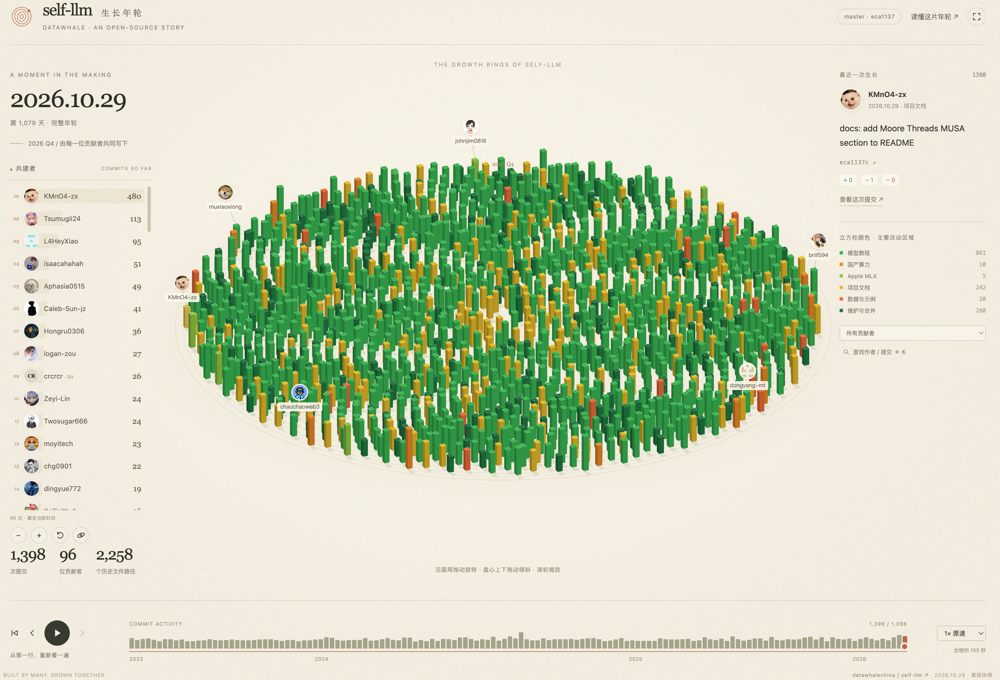

# Commit Rings Skill

把一个仓库的 Git 历史，长成一片可以拨动、回放和探索的年轮。

An agent skill that turns Git history into an interactive growth-ring visualization in a single HTML file.

用户只需要告诉 Agent：

```text
用 commit-rings-skill 展示 datawhalechina/self-llm
```

在已经选中这个 Skill 的会话里，直接输入 `datawhalechina/self-llm` 即可。Agent 会读取真实提交历史，生成一个双击就能打开的 `self-llm-history.html`，不需要手动导出 Git 日志或准备头像。



[查看 Skill](skills/commit-rings-skill/SKILL.md) · [下载并打开 self-llm 示例](skills/commit-rings-skill/examples/self-llm-history.html) · [示例来源](skills/commit-rings-skill/examples/README.md)

## 安装

仓库发布后，可通过支持 Agent Skills 的工具安装：

```bash
npx skills add KMnO4-zx/commit-rings-skill -g -y
```

本地开发时，在本仓库目录安装：

```bash
npx skills add . -g -y
```

也可以把 `skills/commit-rings-skill` 整个目录复制到你的 Agent 支持的 skills 目录。Skill 本身不要求特定厂商的浏览器工具或 MCP。

生成器需要 **Python 3.10+ 和 Git**，没有 pip 依赖。联网用于首次获取 Git 历史及 GitHub 作者、头像；生成后的 HTML 内嵌 CSS、JavaScript、数据和头像，离线可播放。点击 GitHub 提交链接时需要联网。

## 你会得到什么

- **黄金角年轮**：一次提交一根立方柱，以约 137.508° 的步长向外排列，季度细环标记时间。
- **两个视角**：斜视是细高柱子；俯视平滑收成更大的小方块，保留高光、边框与阴影。
- **同色高亮**：绿色提亮绿色、橙色提亮橙色，保持各类别的辨识度。
- **直接拨动圆盘**：沿圆周拖动旋转，盘心上下拖动调整倾角，Shift＋拖动也可调倾角，滚轮缩放。
- **贡献者动态榜**：头像、GitHub 名称和截至当前时间的累计次数，随回放重排，支持追踪作者。
- **时间与细节**：播放、倍速、逐条浏览、搜索、提交详情、GitHub diff 跳转和全屏。

默认通用分类是源码、文档、测试、构建与配置、资源与数据、维护与合并，按变更文件路径自动判断。颜色表示类别，柱高与变更路径数有关，均不衡量贡献质量。

## 不通过 Agent，也能生成

只输入仓库名，输出默认写在当前目录：

```bash
python3 skills/commit-rings-skill/scripts/build_history.py datawhalechina/self-llm
```

其他可选用法：

```bash
# 指定输出文件
python3 skills/commit-rings-skill/scripts/build_history.py owner/repo -o output/repo-history.html

# 只读已有完整克隆；省去下载 Git 历史，仍查询 GitHub 作者
python3 skills/commit-rings-skill/scripts/build_history.py owner/repo --local-repo /path/to/repo

# 用已有克隆和缓存离线生成；没有账号缓存时使用 Git 署名和缩写
python3 skills/commit-rings-skill/scripts/build_history.py owner/repo --local-repo /path/to/repo --offline
```

`--ref` 可指定分支、tag 或 commit；`--no-github` 跳过账号查询；`--refresh-authors` 更新已缓存的账号映射。全部参数见 `--help`。

默认缓存位置是 `~/.cache/commit-rings-skill/`。脚本仅下载 Git 元数据，不检出或运行目标仓库代码，不更改用户的本地克隆，不自动 commit 或 push。

## 真实数据与边界

默认包含默认分支快照可达的全部 commit，含 merge，按 Git 提交者时间回放，日期显示 UTC+8。浅克隆和没有提交的仓库会明确报错。历史路径数包含已删除路径；merge 不重复统计文件 diff，因此不包含只在合并解决过程中出现的路径。

贡献者按 GitHub 返回的作者账号 ID 合并。API 无法匹配时保留 Git 姓名和 Git 标记，不通过同名猜账号。作者邮箱字段不会写进 HTML。公开仓库可不登录生成；API 限流或不可用时，真实 Git 历史仍可展示，但 GitHub 名称/头像可能不完整，页面会显示账号关联覆盖率。

已有 `gh` 登录、`GH_TOKEN` 或 `GITHUB_TOKEN` 可供 API 查询使用；Git fetch 仍使用本机已有 Git 凭据。私有仓库需要访问权限，生成文件也会包含该仓库的提交信息。

没有静默抽样或提交数上限；上万条提交的仓库会占用更多内存、生成更大的文件，浏览器交互也可能变慢。


## 仓库结构

```text
skills/commit-rings-skill/
├── SKILL.md                         # Agent 入口
├── agents/openai.yaml               # Skill 展示信息
├── scripts/build_history.py         # Git 采集、作者关联、单 HTML 生成
├── assets/history.template.html     # 可复用的交互模板
├── references/
│   ├── visual-design.md             # 本次迭代确认的视觉和手势
│   └── data-and-generation.md       # 数据口径、缓存和字段契约
└── examples/
    ├── README.md                    # 示例来源和快照说明
    └── self-llm-history.html         # 原样保留的定制示例
```

原始示例保留 self-llm 的模型教程/硬件分类，通用生成器使用路径分类；两者不是同一个分类配置。示例中的数据固定在其快照，新生成文件会读取当前目标 ref。

## 开发与打包

```bash
make test
make package
```

测试使用临时 Git 仓库，检查合并、重命名、删除、中文与特殊路径、身份归组、API 分页及限流、HTML 转义、单提交与浅克隆。不依赖网络或 GitHub 凭据。

打包产物为 `dist/commit-rings-skill.zip`，ZIP 根目录含 `SKILL.md`，包含模板、生成脚本、参考说明、示例和许可证。GitHub Actions 执行相同的离线测试与打包，不自动发布。

## 来源

仓库组织与 Skill 分发形式参考 [SwanHubX/pytrio-skill](https://github.com/SwanHubX/pytrio-skill)。视觉灵感来自 [The Growth Rings of SGLang Omni](https://x.com/GenAI_is_real/status/2120417053882376383)，本项目从 self-llm 的年轮可视化迭代中整理而来。

代码采用仓库现有的 [Apache-2.0](LICENSE) 许可证。示例中的仓库元数据、贡献者署名和头像保留原来源。
